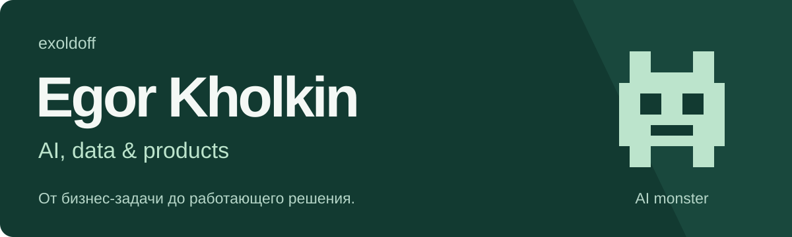

# Привет, я Егор 👋

**Собираю AI-продукты, работаю с данными и автоматизирую то, что надоело делать руками.**

По образованию — экономист, по интересам — человек на стыке бизнеса, аналитики и разработки. Мне нравится весь путь: разобраться в задаче, проверить гипотезу, собрать решение и посмотреть, как оно работает у пользователя.

Развиваю [Holkins](https://holkins.ru/) — агентство автоматизации бизнеса. Делаю собственные проекты с LLM, поиском по документам и машинным обучением. Использую ИИ-ассистентов в разработке: быстро собираю прототипы, разбираю ошибки и проверяю результат.

[Holkins](https://holkins.ru/) · [ML-проект](https://github.com/exoldoff/mpstats_etl_ml_dedup) · [Модель на Hugging Face](https://huggingface.co/exoldoff/bge-reranker-v2-m3-cross-encoder-marketplaces-rus) · [Портфолио аналитики](https://github.com/exoldoff/portfolio)

## Что делаю

- **AI и агенты.** Поиск по документам, работа с источниками, сценарии для LLM и интеграции с бизнес-процессами.
- **Данные и ML.** От сырых выгрузок и разметки до пайплайна, оценки моделей и интерфейса, которым можно пользоваться.
- **Продукт и автоматизация.** Разбираю процесс вместе с заказчиком, выбираю приоритеты и собираю MVP. Начинаю с задачи — потом выбираю технологию.

## Проекты, которые стоит посмотреть

### [MPStats: ETL и ML-дедупликация товаров](https://github.com/exoldoff/mpstats_etl_ml_dedup)

Локальное веб-приложение для аналитики маркетплейсов: собирает выгрузки, приводит их к общей структуре и находит одинаковые товары с разными названиями. Собрал путь от подготовки данных до ML-модели и её интеграции в приложение.

Поиск кандидатов — эмбеддинги и FAISS, сопоставление пар — дообученный BGE cross-encoder. В отчётной конфигурации **F1 — 0,886 на отложенном тесте из 165 пар**. Пороги учитывают стоимость ошибочного объединения товаров.

`Python` `DuckDB` `PyTorch` `Sentence Transformers` `FAISS` `FastAPI` `React`

[Код и методология](https://github.com/exoldoff/mpstats_etl_ml_dedup#ml-результаты) · [Опубликованная модель](https://huggingface.co/exoldoff/bge-reranker-v2-m3-cross-encoder-marketplaces-rus)

### Juristic — исследование юридических документов

Разрабатываю прототип ИИ-агента для юристов: обработка PDF и OCR, поиск по материалам дела, сбор судебной практики и подготовка отчёта. Особое внимание — проверяемости: цитаты с указанием страниц, проверка расчётов, явные пробелы в материалах и контроль бюджета моделей.

`Python` `LLM` `RAG` `OCR` `Проверка источников`

### ALEPH — кейс Альфа-Банка на AI Product Hack

В команде работал над прототипом ИИ-аналитика для проверки и сравнения контрагентов. Проводил интервью с кейсодателем, формулировал гипотезы и сценарии, участвовал в разработке backend и frontend, разбирал тесты и готовил демо.

Сервер рассчитывает показатели и собирает источники, модель объясняет данные. Результат — диалог о компании, сравнение контрагентов и PDF-отчёт.

`AI agents` `Аналитика` `Backend / Frontend` `Продуктовые гипотезы`

## База, на которую опираюсь

- **СПбГУ, 2026** — бакалавриат, экономический факультет.
- **ИТМО / AI Talent Hub** — магистратура «Искусственный интеллект», ожидаемый выпуск в 2028 году.
- **Победитель Junior ML Contest 2026** с проектом ML-дедупликации товаров.
- Опыт бизнес-аналитики и автоматизации в FMCG и ритейле.

## С чем работаю

**Данные:** Python, SQL, pandas, DuckDB, Power BI, DataLens. 
**AI / ML:** PyTorch, Sentence Transformers, FAISS, LLM API, RAG. 
**Приложения:** FastAPI, React, Git, Docker.

Мне интересны задачи, где нужно связать бизнес-контекст, данные и работающий интерфейс. Люблю, когда можно открыть результат, проверить логику и понять, что именно стало проще.

## На связи

Обсудить автоматизацию или совместный проект — [через Holkins](https://holkins.ru/kontakty/). Посмотреть больше обо мне — [здесь](https://holkins.ru/obo-mne/).

Санкт-Петербург · AI monster 😈 · всё ещё лысый 👨‍🦲
